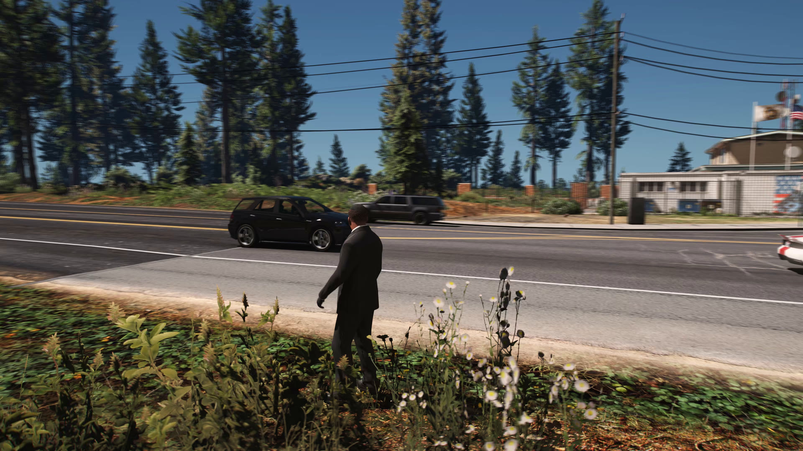
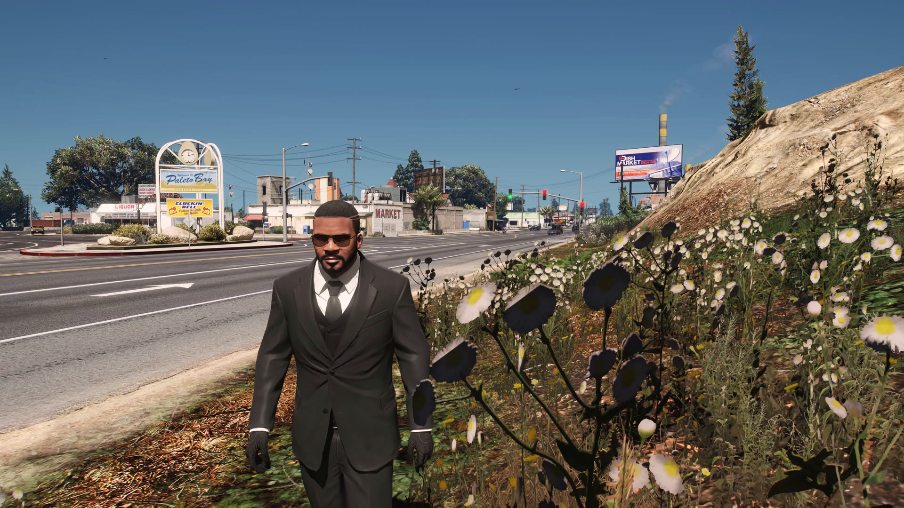
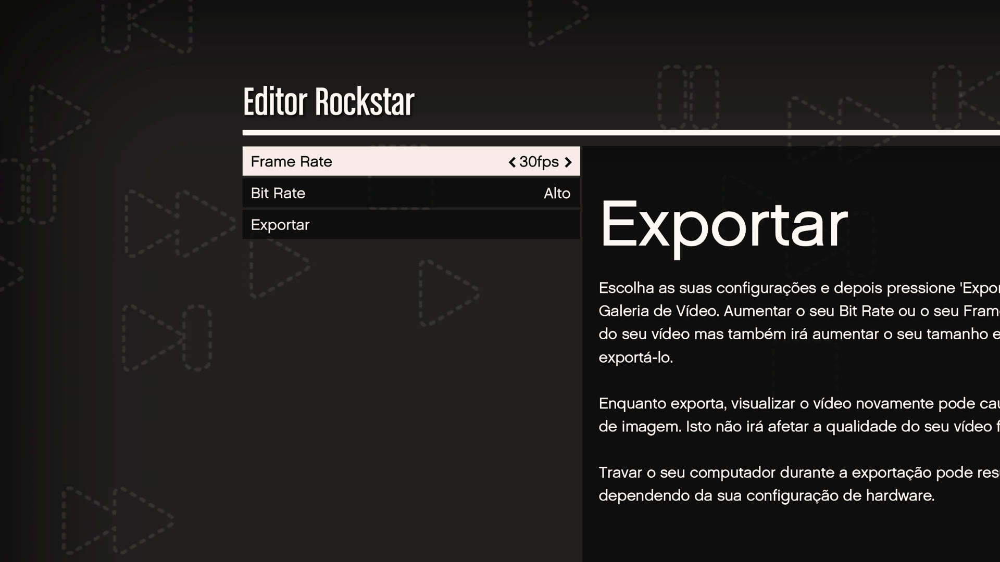

# EVER Enhanced

[](README.md)
[](README.pt-BR.md)
[](README.es.md)

[](LICENSE)
[](ENHANCED_PORT.md)

<!-- compatibility-status:start -->
> [!CAUTION]
> **Aviso de compatibilidad:** Steam distribuye ahora GTA V Enhanced compilación
> `25261616`, pero EVER Enhanced solo se validó con el juego `1.0.1158.13` /
> compilación de Steam `24129078` (2026-07-30). No supongas que los
> hooks específicos de esta versión son seguros hasta que se retire este aviso.
<!-- compatibility-status:end -->

**EVER Enhanced (Extended Video Export Revived)** elimina las limitaciones
normales de exportación del Editor Rockstar en GTA V Enhanced. El mod captura
la imagen real renderizada por el juego antes de la interfaz de exportación de
Rockstar y la codifica con la resolución, frecuencia de fotogramas, códec,
contenedor, audio y desenfoque de movimiento elegidos por el usuario.

Este proyecto es la adaptación para Enhanced de
[EVER de MiffedLyric559](https://github.com/MiffedLyric559/EVER), que continúa
el [EVE original de Ali Alidoust](https://github.com/ali-alidoust/gta5-extended-video-export).
El historial y los créditos del proyecto original se conservaron.

> La primera versión pública para Enhanced debe considerarse beta. Se validó
> con GTA V Enhanced 1.0.1158.13 y ScriptHookV 3889.0. Una actualización del
> juego puede cambiar funciones internas y requerir una actualización de EVER.

Lee las [notas completas de v2.0.0-beta.2](docs/RELEASE_NOTES_v2.0.0-beta.2.md)
para conocer los cambios del port, pruebas, instalación y limitaciones.

## Descarga e instalación

### Antes de empezar

EVER Enhanced está destinado actualmente a la versión indicada en el aviso de
compatibilidad anterior. No fuerces su carga tras una actualización de GTA si
el aviso indica que la nueva compilación aún no ha sido validada.

Necesitas:

- una copia legal de **GTA V Enhanced para Windows** (no GTA V Legacy);
- una versión de [ScriptHookV](https://www.dev-c.com/gtav/scripthookv/) que
  admita expresamente tu compilación de Enhanced;
- [ReShade](https://reshade.me/) instalado para DirectX 12 con **compatibilidad
  completa de complementos**; y
- suficiente espacio libre y memoria de GPU para la exportación elegida.

ScriptHookV y ReShade son requisitos independientes y no se incluyen con EVER
Enhanced.

### 1. Descarga el archivo correcto

Abre [la página de versiones de EVER Enhanced](https://github.com/rossignolli/EVER-Enhanced/releases),
despliega **Assets** y descarga `EVER-Enhanced-<versión>.zip`. No descargues los
archivos “Source code” generados automáticamente por GitHub: no contienen el
mod compilado ni sus DLL de ejecución.

El archivo `.zip.sha256` correspondiente es opcional, pero permite comprobar
que el ZIP se descargó correctamente. Si Windows marca el archivo como
bloqueado, abre sus Propiedades y elige **Desbloquear** antes de extraerlo.

### 2. Instala los requisitos

1. Descarga [ScriptHookV desde su página oficial](https://www.dev-c.com/gtav/scripthookv/)
   e instálalo en la carpeta que contiene `GTA5_Enhanced.exe`. Comprueba que la
   versión indicada sea compatible con tu compilación de Enhanced.
2. Descarga [ReShade desde su sitio oficial](https://reshade.me/), ejecuta el
   instalador y selecciona `GTA5_Enhanced.exe`, no el ejecutable de Legacy.
3. Selecciona el renderizador **DirectX 12** y la versión de ReShade con
   **compatibilidad completa de complementos**. Una versión restringida no
   puede cargar la captura de EVER.

### 3. Extrae EVER Enhanced

Cierra primero el juego. Haz una copia de cualquier `zEVER.asi` y carpeta `EVER`
existentes; después extrae el contenido del ZIP directamente en la carpeta que
contiene `GTA5_Enhanced.exe`.

La estructura final debe ser:

```text
GTA V Enhanced/
|-- GTA5_Enhanced.exe
|-- zEVER.asi
`-- EVER/
    |-- EVER.ini
    |-- preset.json
    |-- EncoderConfig.exe
    |-- dlls/
    `-- presets/
```

`zEVER.asi` debe quedar junto al ejecutable del juego, no dentro de la carpeta
`EVER`. El prefijo `z` hace que ReShade se cargue antes de EVER; no cambies el
nombre del archivo.

### 4. Comprueba el primer inicio

1. Inicia el **Modo Historia**.
2. Pulsa `Home` para abrir ReShade y entra en la pestaña de complementos.
3. Comprueba que EVER muestre `GTA V Enhanced` y `Enhanced compatibility mode`.
4. Si EVER no aparece, no empieces a exportar. Revisa el ejecutable seleccionado
   en ReShade, la compatibilidad completa de complementos, la versión de
   ScriptHookV y la estructura de carpetas anterior.

### 5. Haz una primera exportación segura

Empieza con un proyecto corto del Editor Rockstar a 1920x1080, 30 FPS, H.264 y
`motion_blur_samples = 0`. Cuando funcione, aumenta la resolución/FPS y añade
desenfoque de movimiento un ajuste cada vez. Así es más fácil distinguir fallos
del codificador, VRAM, captura o doble pasada.

Consulta la [guía completa de instalación y uso](docs/INSTALL_ENHANCED.md) para
ejemplos de configuración, ubicación de salida, solución de problemas y
desinstalación.

## Pruebas de la versión actual

Estas son imágenes reales extraídas de las pruebas completas con el Editor
Rockstar, no capturas tomadas fuera de la exportación. Las vistas previas se
redujeron a 1920x1080 para mantener pequeño el historial del repositorio; los
fotogramas originales son de 3840x2160.



AV1 NVENC, 3840x2160, 120 FPS, tres muestras adicionales de desenfoque de
movimiento (480 renderizados efectivos por segundo), audio AAC, 1852 fotogramas
y ninguno perdido. Los árboles, cables y vehículos en movimiento muestran la
acumulación temporal; la interfaz de exportación de Rockstar no aparece.



H.264 NVENC, 3840x2160, 240 FPS exactos mediante el flujo de audio de dos
pasadas, 3704 fotogramas y ninguno perdido. El resultado no contiene la
interfaz de progreso ni la marca de agua de Rockstar.



Las pruebas comienzan desde el menú normal de exportación del Editor Rockstar.
EVER sustituye la ruta limitada de captura y codificación conservando el flujo
de trabajo habitual del editor.

| Componente validado | Versión |
| --- | --- |
| Ejecutable de GTA V Enhanced | `1.0.1158.13` |
| Actualización de título de Rockstar | `1.73` (16 de julio de 2026) |
| ScriptHookV | `3889.0.1158.13` |
| ReShade | `6.7.3` con compatibilidad completa de complementos |
| Fecha de validación | 30 de julio de 2026 |

Consulta el [registro reproducible de validación](docs/VALIDATION.md) para ver
los hashes del ejecutable, los metadatos de salida y la diferencia entre una
versión probada y una futura versión que solo se supone compatible.

## Qué añade

- Exportación a la resolución real del juego/ReShade, incluido 4K probado.
- Frecuencias enteras personalizadas probadas a 24, 30, 60, 120 y 240 FPS.
- Captura limpia antes de la interfaz de progreso y la marca de agua de Rockstar.
- Audio sincronizado a altas tasas de renderizado mediante un flujo automático
  de audio primero y vídeo después.
- Acumulación de desenfoque de movimiento por GPU en DirectX 12 de GTA V Enhanced.
- Perfiles H.264, H.265, AV1, VP9, ProRes y OpenEXR, según los codificadores
  presentes en la versión instalada.
- Configuraciones MP4/AAC, MKV/FLAC, AVI/MP3, MOV/PCM y WebM/Opus.
- Perfiles NVIDIA NVENC, AMD AMF e Intel QSV, además de codificadores por CPU.
- Secuencias OpenEXR sincronizadas de color y profundidad.

La implementación y los resultados detallados están documentados en
[ENHANCED_PORT.md](ENHANCED_PORT.md).

## Uso rápido

1. Crea y guarda un clip en el Editor Rockstar.
2. Edita `EVER/EVER.ini` o usa los controles de EVER en ReShade.
3. Cuando sea necesario, elige un perfil con `EVER/EncoderConfig.exe`.
4. Inicia la exportación normal del Editor Rockstar. EVER sustituye el vídeo y
   el audio capturados; no interrumpas una exportación de dos pasadas entre ellas.
5. El archivo final estará en `output_folder`. Si está vacío, EVER usará la
   carpeta Vídeos de Windows.

Ajustes importantes en `EVER/EVER.ini`:

| Ajuste | Función |
| --- | --- |
| `fps` | Frecuencia de fotogramas del resultado final. |
| `motion_blur_samples` | Muestras temporales adicionales por fotograma final. |
| `motion_blur_strength` | Intensidad del obturador usada en la acumulación. |
| `export_openexr` | Escribe una secuencia EXR de color/profundidad además del vídeo. |
| `disable_watermark` | Solicita eliminar la marca; la captura limpia de Enhanced ya excluye la interfaz de Rockstar. |
| `output_folder` | Carpeta de destino; vacía, usa Vídeos de Windows. |
| `log_level` | Usa `debug` al informar de un problema. |

La tasa efectiva de renderizado es `fps * (motion_blur_samples + 1)`. Por encima
de 60, EVER Enhanced captura automáticamente audio y vídeo en pasadas separadas
para mantener la sincronización. La escritura final es asíncrona; espera a que
termine antes de cerrar el juego.

## Compatibilidad y limitaciones conocidas

- La ruta Enhanced depende de la versión. El código desconocido se rechaza en
  vez de parchearse con una dirección de Legacy que no haya sido validada.
- Las frecuencias fraccionarias aún requieren validación explícita en el juego.
- FiveM no ha sido validado por esta batería de pruebas de Enhanced.
- No se han identificado planos nativos adicionales del G-buffer más allá de
  color y profundidad.
- ProRes y AV1 por CPU pueden ser lentos en 4K. Los perfiles de hardware exigen
  una GPU y un controlador compatibles.
- El perfil AV1 NVENC usa YUV420 de 8 bits y cuatro superficies del codificador
  para dejar memoria disponible a GTA, ReShade y los mods gráficos.

Los usuarios de GTA V Legacy deben usar una versión apropiada del
[proyecto EVER original](https://github.com/MiffedLyric559/EVER/releases).

## Compilar desde el código fuente

Requisitos:

- Visual Studio 2022 con Desarrollo para escritorio con C++ y un Windows SDK reciente.
- CMake 3.15 o posterior.
- Git con compatibilidad para submódulos.
- El SDK de ScriptHookV copiado en `ScriptHookV/inc` y `ScriptHookV/lib`.

```powershell
git clone --recursive <url-del-repositorio> EVER-Enhanced
cd EVER-Enhanced
.\build.bat
```

La compilación usa los submódulos fijados de ReShade y vcpkg y escribe el paquete
en `x64/Release`. Voukoder no se usa en la ruta FFmpeg de Enhanced.

## Informar de errores

Incluye estos datos en el issue de GitHub:

- Versión y tienda de GTA V Enhanced.
- Versiones de ScriptHookV y ReShade.
- Modelo de GPU y versión del controlador.
- El `EVER.ini` y el perfil de codificación activos.
- `EVER/EVER.log` con `log_level = debug`.
- Si funciona una exportación corta sin desenfoque de movimiento.

No subas archivos protegidos del juego ni credenciales de tu cuenta.

## Licencia y créditos

El código se distribuye bajo la [Licencia Apache 2.0](LICENSE). Consulta
[NOTICE](NOTICE) para el aviso de cambios y atribución. Los archivos binarios
también incluyen las licencias de las bibliotecas de terceros incorporadas.

EVE original: Ali Alidoust. Recuperación y mantenimiento de EVER: MiffedLyric,
TheGreyRaven y colaboradores. Adaptación para GTA V Enhanced: colaboradores de
EVER Enhanced.

Grand Theft Auto, GTA V y Rockstar Games son marcas de sus respectivos
propietarios. Este proyecto comunitario no está afiliado ni respaldado por
Rockstar Games.
