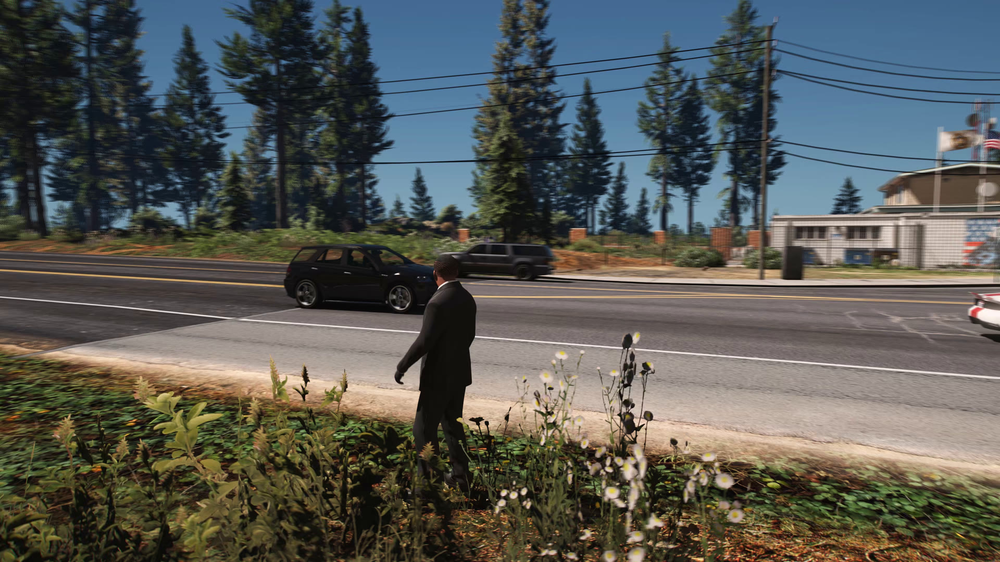
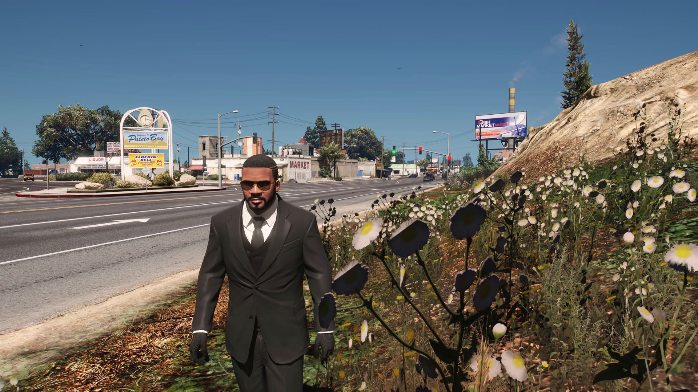
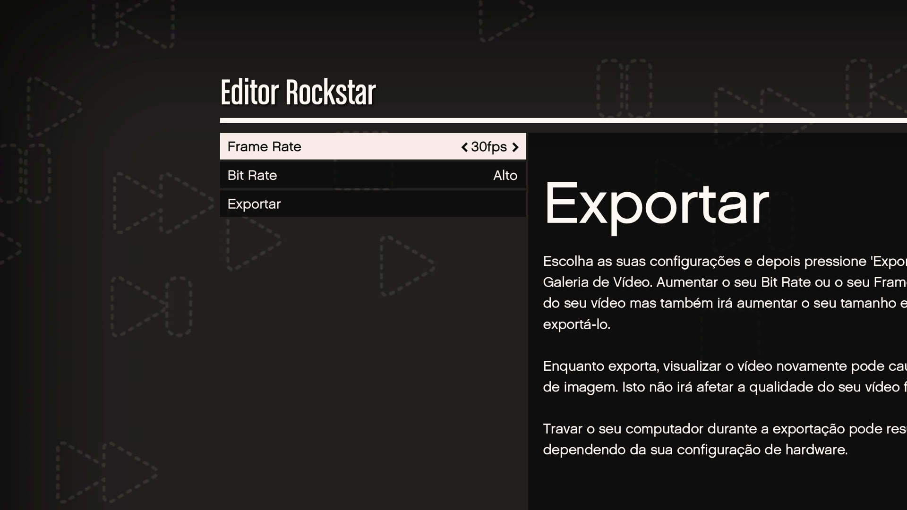

# EVER Enhanced

[](README.md)
[](README.pt-BR.md)
[](README.es.md)

[](LICENSE)
[](ENHANCED_PORT.md)

<!-- compatibility-status:start -->
> [!IMPORTANT]
> **Compatibility status:** validated for GTA V Enhanced `1.0.1158.13`
> (Steam build `24129078`), tested on 2026-07-30.
<!-- compatibility-status:end -->

**EVER Enhanced (Extended Video Export Revived)** removes Rockstar Editor's
normal export limitations on GTA V Enhanced. It captures the real game render
target before Rockstar's export UI and encodes it with the resolution, frame
rate, codec, container, audio, and motion-blur settings selected by the user.

This project is an Enhanced port of
[MiffedLyric559/EVER](https://github.com/MiffedLyric559/EVER), which continues
[Ali Alidoust's original EVE](https://github.com/ali-alidoust/gta5-extended-video-export).
The upstream history and attribution are intentionally preserved.

> The first public Enhanced build should be treated as a beta. It has been
> validated on GTA V Enhanced 1.0.1158.13 with ScriptHookV 3889.0. A game update
> can change internal functions and require a compatible EVER update.

## Evidence from the current build

These are real frames extracted from the end-to-end Rockstar Editor tests, not
in-game screenshots taken outside the export path. The repository previews are
reduced to 1920x1080 to keep the Git history small; their source frames are
3840x2160.



AV1 NVENC, 3840x2160, 120 FPS output, three additional motion-blur samples
(480 effective renders per second), AAC audio, 1,852 frames, and zero dropped
frames. The moving trees, wires, and vehicles show the accumulated temporal
samples; Rockstar's export UI is absent.



H.264 NVENC, 3840x2160, exact 240 FPS output through the dual-pass audio path,
3,704 frames, and zero dropped frames. The image is the clean encoded output,
without Rockstar's progress interface or watermark.



The tests start through Rockstar Editor's normal export menu. EVER then replaces
the limited capture/encoding path while keeping the editor workflow familiar.

| Validated component | Version |
| --- | --- |
| GTA V Enhanced executable | `1.0.1158.13` |
| Rockstar title update | `1.73` (July 16, 2026) |
| ScriptHookV | `3889.0.1158.13` |
| ReShade | `6.7.3` with full add-on support |
| Validation date | July 30, 2026 |

See [the reproducible validation record](docs/VALIDATION.md) for executable
hashes, output metadata, and the distinction between a tested version and a
future compatible version.

## What it adds

- Exports at the actual game/ReShade render resolution, including tested 4K.
- Custom integer frame rates tested at 24, 30, 60, 120, and 240 FPS.
- Clean capture before Rockstar's progress UI and watermark.
- Synchronized audio at high effective render rates through an automatic
  audio-first/video-second workflow.
- GPU motion-blur accumulation on the GTA V Enhanced DirectX 12 path.
- H.264, H.265, AV1, VP9, ProRes, and OpenEXR presets, subject to the encoders
  present in the selected release build.
- MP4/AAC, MKV/FLAC, AVI/MP3, MOV/PCM, and WebM/Opus configurations.
- NVIDIA NVENC, AMD AMF, and Intel QSV presets, plus CPU encoders.
- OpenEXR color and synchronized depth sequences.

The exact implementation and end-to-end test results are documented in
[ENHANCED_PORT.md](ENHANCED_PORT.md).

## Requirements

- A legally installed copy of GTA V Enhanced for Windows.
- A ScriptHookV release that explicitly supports the installed Enhanced build.
- ReShade installed for `GTA5_Enhanced.exe`, using DirectX 12 and **full add-on
  support**.
- Enough free storage for the chosen resolution, frame rate, codec, and EXR
  settings. OpenEXR sequences can grow very quickly.

ScriptHookV and ReShade are not bundled with EVER Enhanced.

## Install

1. Download the latest `EVER-Enhanced-*.zip` from this repository's Releases
   section.
2. Install a GTA V Enhanced-compatible ScriptHookV in the game directory.
3. Install ReShade for `GTA5_Enhanced.exe`; choose DirectX 12 and the build with
   full add-on support.
4. Extract the release ZIP into the GTA V Enhanced directory. The resulting
   layout must contain `zEVER.asi` and the `EVER` directory next to the game
   executable.
5. Start the game and open ReShade with `Home`. In the add-ons tab, verify that
   EVER reports `GTA V Enhanced` and `Enhanced compatibility mode`.

The `z` prefix is deliberate: it makes ReShade load before the EVER add-on.
Do not rename `zEVER.asi`.

See [the complete installation and usage guide](docs/INSTALL_ENHANCED.md) for
configuration, export steps, output locations, and troubleshooting.

## Quick use

1. Create and save a clip in Rockstar Editor.
2. Edit `EVER/EVER.ini` or use EVER's controls in ReShade's add-ons tab.
3. Select an encoder preset with `EVER/EncoderConfig.exe` when needed.
4. Start the normal Rockstar Editor export. EVER replaces the captured video
   and audio path; do not interrupt a dual-pass export between its two passes.
5. Find the final file in `output_folder`. If that field is empty, EVER uses the
   Windows Videos directory.

Important settings in `EVER/EVER.ini`:

| Setting | Meaning |
| --- | --- |
| `fps` | Final output frame rate. |
| `motion_blur_samples` | Additional temporal samples per output frame. |
| `motion_blur_strength` | Shutter strength used by the accumulation pass. |
| `export_openexr` | Writes a color/depth EXR sequence in addition to video. |
| `disable_watermark` | Requests watermark suppression; Enhanced clean capture already excludes Rockstar's export UI. |
| `output_folder` | Destination directory; blank uses Windows Videos. |
| `log_level` | Use `debug` when reporting a problem. |

The effective render rate is `fps * (motion_blur_samples + 1)`. Above 60,
EVER Enhanced automatically captures audio and video in separate passes to
keep them synchronized. Final container writing is asynchronous, so wait for
completion before closing the game.

## Compatibility and known limitations

- The Enhanced path is version-sensitive. Unsupported game code is rejected
  rather than patched with an unverified Legacy address.
- Fractional frame rates still require explicit in-game validation.
- FiveM has not been validated by this Enhanced test suite.
- Additional native G-buffer planes beyond color and depth have not been
  identified in Enhanced.
- ProRes and CPU AV1 can be slow at 4K. Hardware presets require a compatible
  GPU and driver.
- The supplied AV1 NVENC preset uses 8-bit YUV420 and four encoder surfaces to
  leave memory available for GTA, ReShade, and visual mods.

Legacy GTA V users should use an appropriate release from the
[upstream EVER project](https://github.com/MiffedLyric559/EVER/releases).

## Build from source

Requirements:

- Visual Studio 2022 with Desktop development with C++ and a recent Windows SDK.
- CMake 3.15 or newer.
- Git with submodule support.
- The ScriptHookV SDK copied into `ScriptHookV/inc` and `ScriptHookV/lib`.

```powershell
git clone --recursive <repository-url> EVER-Enhanced
cd EVER-Enhanced
.\build.bat
```

The build uses the pinned ReShade and vcpkg submodules and writes the runtime
package tree under `x64/Release`. Voukoder is not used by the Enhanced FFmpeg
pipeline.

## Reporting bugs

Attach these details to a GitHub issue:

- GTA V Enhanced version and storefront.
- ScriptHookV and ReShade versions.
- GPU model and driver version.
- The active `EVER.ini` and encoder preset.
- `EVER/EVER.log` with `log_level = debug`.
- Whether a short export without motion blur succeeds.

Never upload copyrighted game files or your account credentials.

## License and attribution

The project source is distributed under the [Apache License 2.0](LICENSE). See
[NOTICE](NOTICE) for the modification and attribution notice. Binary release
archives also contain the licenses of their bundled third-party libraries.

Original EVE: Ali Alidoust. EVER revival and maintenance: MiffedLyric,
TheGreyRaven, and contributors. GTA V Enhanced port: EVER Enhanced
contributors.

Grand Theft Auto, GTA V, and Rockstar Games are trademarks of their respective
owners. This community project is not affiliated with or endorsed by Rockstar
Games.
