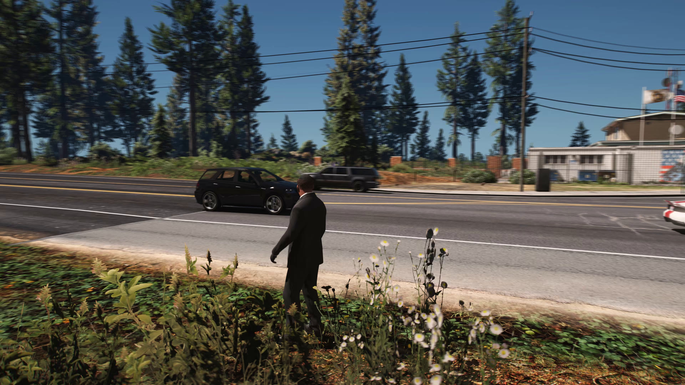
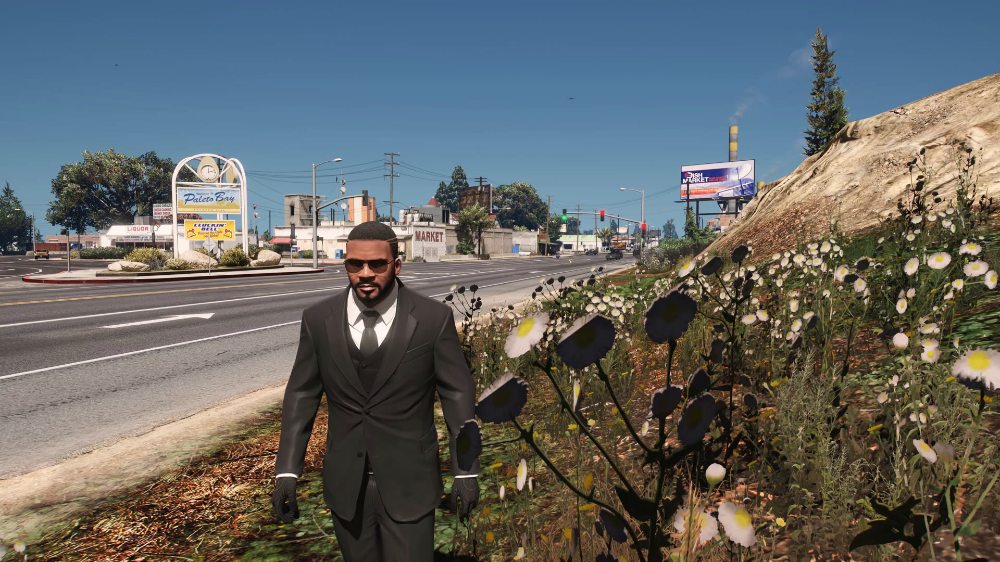
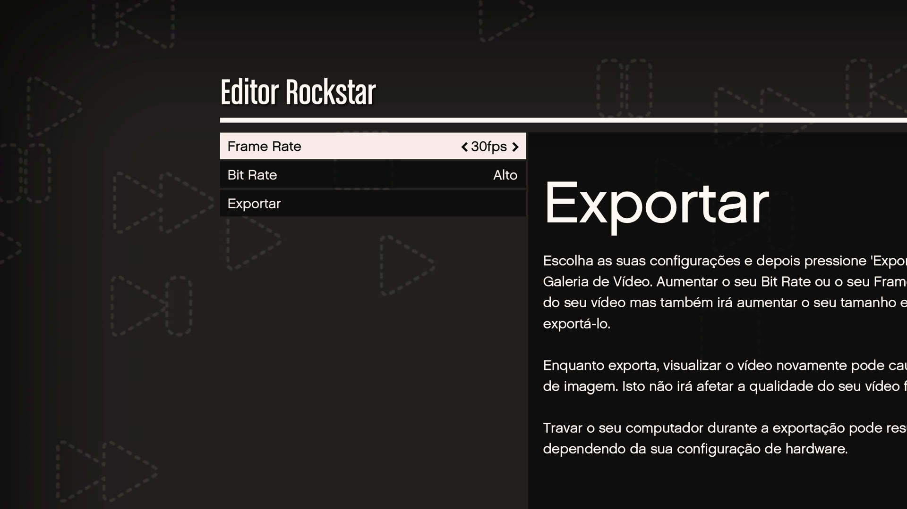

# EVER Enhanced

[](README.md)
[](README.pt-BR.md)
[](README.es.md)

[](LICENSE)
[](ENHANCED_PORT.md)

<!-- compatibility-status:start -->
> [!IMPORTANT]
> **Estado de compatibilidade:** validado no GTA V Enhanced `1.0.1158.13`
> (build Steam `24129078`), testado em 2026-07-30.
<!-- compatibility-status:end -->

**EVER Enhanced (Extended Video Export Revived)** remove as limitações normais
de exportação do Editor Rockstar no GTA V Enhanced. O mod captura a imagem real
renderizada pelo jogo antes da interface de exportação da Rockstar e a codifica
com a resolução, taxa de quadros, codec, contêiner, áudio e motion blur escolhidos
pelo usuário.

Este projeto é a adaptação para Enhanced do
[EVER de MiffedLyric559](https://github.com/MiffedLyric559/EVER), que dá
continuidade ao [EVE original de Ali Alidoust](https://github.com/ali-alidoust/gta5-extended-video-export).
O histórico e os créditos do projeto original foram preservados.

> A primeira versão pública para Enhanced deve ser considerada beta. Ela foi
> validada no GTA V Enhanced 1.0.1158.13 com ScriptHookV 3889.0. Uma atualização
> do jogo pode alterar funções internas e exigir uma atualização do EVER.

## Download e instalação

### Antes de começar

O EVER Enhanced atualmente é destinado à versão mostrada no aviso de
compatibilidade acima. Não force o carregamento depois de uma atualização do
GTA quando o aviso disser que a nova build ainda não foi validada.

Você precisa de:

- uma cópia legal do **GTA V Enhanced para Windows** (não o GTA V Legacy);
- uma versão do ScriptHookV que declare suporte à sua build do Enhanced;
- ReShade instalado para DirectX 12 com **suporte completo a add-ons**; e
- espaço livre e memória da GPU suficientes para a exportação escolhida.

ScriptHookV e ReShade são requisitos separados e não vêm dentro do pacote do
EVER Enhanced.

### 1. Baixe o arquivo correto

Abra [a versão mais recente do EVER Enhanced](https://github.com/rossignolli/EVER-Enhanced/releases/latest),
expanda **Assets** e baixe `EVER-Enhanced-<versão>.zip`. Não baixe os arquivos
“Source code” gerados automaticamente pelo GitHub: eles não contêm o mod
compilado nem as DLLs necessárias.

O arquivo `.zip.sha256` correspondente é opcional, mas permite conferir se o
ZIP foi baixado sem corrupção. Se o Windows marcar o arquivo como bloqueado,
abra suas Propriedades e escolha **Desbloquear** antes de extrair.

### 2. Instale os requisitos

1. Instale um ScriptHookV compatível com GTA V Enhanced na pasta que contém
   `GTA5_Enhanced.exe`, seguindo as instruções do autor.
2. Abra o instalador do ReShade e selecione `GTA5_Enhanced.exe` — não o
   executável da versão Legacy.
3. Selecione o renderizador **DirectX 12** e a versão do ReShade com **suporte
   completo a add-ons**. Uma versão restrita não consegue carregar a captura
   do EVER.

### 3. Extraia o EVER Enhanced

Primeiro feche o jogo. Faça backup de qualquer `zEVER.asi` e pasta `EVER`
existentes; depois extraia o conteúdo do ZIP diretamente na pasta que contém
`GTA5_Enhanced.exe`.

A estrutura final deve ser:

```text
GTA V Enhanced/
|-- GTA5_Enhanced.exe
|-- zEVER.asi
`-- EVER/
    |-- EVER.ini
    |-- preset.json
    |-- EncoderConfig.exe
    |-- dlls/
    `-- presets/
```

O `zEVER.asi` deve ficar ao lado do executável, e não dentro da pasta `EVER`.
O prefixo `z` faz o ReShade carregar antes do EVER; portanto, não renomeie o
arquivo.

### 4. Confira a primeira inicialização

1. Inicie o **Modo História**.
2. Pressione `Home` para abrir o ReShade e entre na aba de add-ons.
3. Confirme que o EVER mostra `GTA V Enhanced` e `Enhanced compatibility mode`.
4. Se o EVER não aparecer, não comece a exportar. Confira o executável escolhido
   no ReShade, o suporte completo a add-ons, a compatibilidade do ScriptHookV e
   a estrutura de pastas acima.

### 5. Faça uma primeira exportação segura

Comece com um projeto curto do Editor Rockstar em 1920x1080, 30 FPS, H.264 e
`motion_blur_samples = 0`. Depois que funcionar, aumente resolução/FPS e adicione
motion blur uma opção por vez. Assim é muito mais fácil identificar problemas
de codificador, VRAM, captura ou duas passagens.

Consulte o [guia completo de instalação e uso](docs/INSTALL_ENHANCED.md) para
exemplos de configuração, pasta de saída, solução de problemas e desinstalação.

## Provas da versão atual

As imagens abaixo são quadros reais extraídos dos testes completos feitos pelo
Editor Rockstar, e não capturas de tela tiradas fora da exportação. As prévias
foram reduzidas para 1920x1080 para manter o repositório leve; os quadros
originais têm 3840x2160.



AV1 NVENC, 3840x2160, 120 FPS, três amostras adicionais de motion blur
(480 renderizações efetivas por segundo), áudio AAC, 1.852 quadros e nenhum
quadro perdido. As árvores, os fios e os veículos em movimento mostram o
acúmulo temporal; a interface de exportação da Rockstar não aparece.



H.264 NVENC, 3840x2160, 240 FPS exatos pelo fluxo de áudio em duas passagens,
3.704 quadros e nenhum quadro perdido. O resultado não contém a interface de
progresso nem a marca-d'água da Rockstar.



Os testes começam pelo menu normal de exportação do Editor Rockstar. O EVER
substitui o caminho limitado de captura e codificação, preservando o fluxo já
conhecido do editor.

| Componente validado | Versão |
| --- | --- |
| Executável do GTA V Enhanced | `1.0.1158.13` |
| Atualização de título da Rockstar | `1.73` (16 de julho de 2026) |
| ScriptHookV | `3889.0.1158.13` |
| ReShade | `6.7.3` com suporte completo a add-ons |
| Data da validação | 30 de julho de 2026 |

Veja o [registro reproduzível de validação](docs/VALIDATION.md) para hashes do
executável, metadados das exportações e a diferença entre uma versão testada e
uma futura versão apenas presumida como compatível.

## O que o mod adiciona

- Exportação na resolução real renderizada pelo jogo/ReShade, incluindo 4K testado.
- Taxas inteiras personalizadas testadas em 24, 30, 60, 120 e 240 FPS.
- Captura limpa antes da interface de progresso e da marca-d'água da Rockstar.
- Áudio sincronizado em taxas efetivas altas por um fluxo automático de áudio
  primeiro e vídeo depois.
- Acúmulo de motion blur pela GPU no caminho DirectX 12 do GTA V Enhanced.
- Predefinições H.264, H.265, AV1, VP9, ProRes e OpenEXR, conforme os
  codificadores presentes na versão instalada.
- Configurações MP4/AAC, MKV/FLAC, AVI/MP3, MOV/PCM e WebM/Opus.
- Predefinições NVIDIA NVENC, AMD AMF e Intel QSV, além de codificadores por CPU.
- Sequências OpenEXR sincronizadas de cor e profundidade.

Os detalhes da implementação e dos testes completos estão em
[ENHANCED_PORT.md](ENHANCED_PORT.md).

## Uso rápido

1. Crie e salve um clipe no Editor Rockstar.
2. Edite `EVER/EVER.ini` ou use os controles do EVER na aba de add-ons do ReShade.
3. Quando necessário, escolha uma predefinição com `EVER/EncoderConfig.exe`.
4. Inicie a exportação normal pelo Editor Rockstar. O EVER substitui o vídeo e
   o áudio capturados; não interrompa uma exportação em duas passagens entre elas.
5. O arquivo final estará em `output_folder`. Se o campo estiver vazio, o EVER
   usará a pasta Vídeos do Windows.

Configurações importantes em `EVER/EVER.ini`:

| Configuração | Função |
| --- | --- |
| `fps` | Taxa de quadros do vídeo final. |
| `motion_blur_samples` | Amostras temporais adicionais por quadro final. |
| `motion_blur_strength` | Intensidade do obturador usada no acúmulo. |
| `export_openexr` | Grava uma sequência EXR de cor/profundidade além do vídeo. |
| `disable_watermark` | Solicita a remoção da marca; a captura limpa no Enhanced já exclui a interface da Rockstar. |
| `output_folder` | Pasta de destino; vazia, usa a pasta Vídeos do Windows. |
| `log_level` | Use `debug` ao relatar um problema. |

A taxa efetiva de renderização é `fps * (motion_blur_samples + 1)`. Acima de 60,
o EVER Enhanced captura áudio e vídeo automaticamente em passagens separadas
para manter a sincronização. A gravação final é assíncrona; aguarde a conclusão
antes de fechar o jogo.

## Compatibilidade e limitações conhecidas

- O caminho Enhanced depende da versão do jogo. Código desconhecido é rejeitado
  em vez de receber endereços do Legacy que ainda não foram validados.
- Taxas fracionárias ainda precisam de validação explícita dentro do jogo.
- FiveM não foi validado por esta suíte de testes do Enhanced.
- Planos nativos adicionais do G-buffer, além de cor e profundidade, ainda não
  foram identificados no Enhanced.
- ProRes e AV1 por CPU podem ser lentos em 4K. Predefinições de hardware exigem
  GPU e driver compatíveis.
- A predefinição AV1 NVENC usa YUV420 de 8 bits e quatro superfícies do codificador
  para deixar memória disponível ao GTA, ReShade e mods gráficos.

Usuários do GTA V Legacy devem usar uma versão adequada do
[projeto EVER original](https://github.com/MiffedLyric559/EVER/releases).

## Compilar o código-fonte

Requisitos:

- Visual Studio 2022 com Desenvolvimento para Desktop com C++ e Windows SDK recente.
- CMake 3.15 ou mais recente.
- Git com suporte a submódulos.
- SDK do ScriptHookV copiado para `ScriptHookV/inc` e `ScriptHookV/lib`.

```powershell
git clone --recursive <url-do-repositório> EVER-Enhanced
cd EVER-Enhanced
.\build.bat
```

A compilação usa os submódulos fixados do ReShade e vcpkg e grava o pacote em
`x64/Release`. O Voukoder não é usado no fluxo FFmpeg da versão Enhanced.

## Relatar problemas

Inclua estas informações na issue do GitHub:

- Versão e loja do GTA V Enhanced.
- Versões do ScriptHookV e ReShade.
- Modelo da GPU e versão do driver.
- `EVER.ini` e predefinição do codificador em uso.
- `EVER/EVER.log` com `log_level = debug`.
- Se uma exportação curta sem motion blur funciona.

Nunca envie arquivos protegidos do jogo nem credenciais da sua conta.

## Licença e créditos

O código é distribuído sob a [Licença Apache 2.0](LICENSE). Consulte o
[NOTICE](NOTICE) para o aviso de alterações e atribuições. Os arquivos binários
também contêm as licenças das bibliotecas de terceiros incluídas.

EVE original: Ali Alidoust. Recuperação e manutenção do EVER: MiffedLyric,
TheGreyRaven e colaboradores. Adaptação para GTA V Enhanced: colaboradores do
EVER Enhanced.

Grand Theft Auto, GTA V e Rockstar Games são marcas de seus respectivos
proprietários. Este projeto comunitário não é afiliado nem endossado pela
Rockstar Games.
