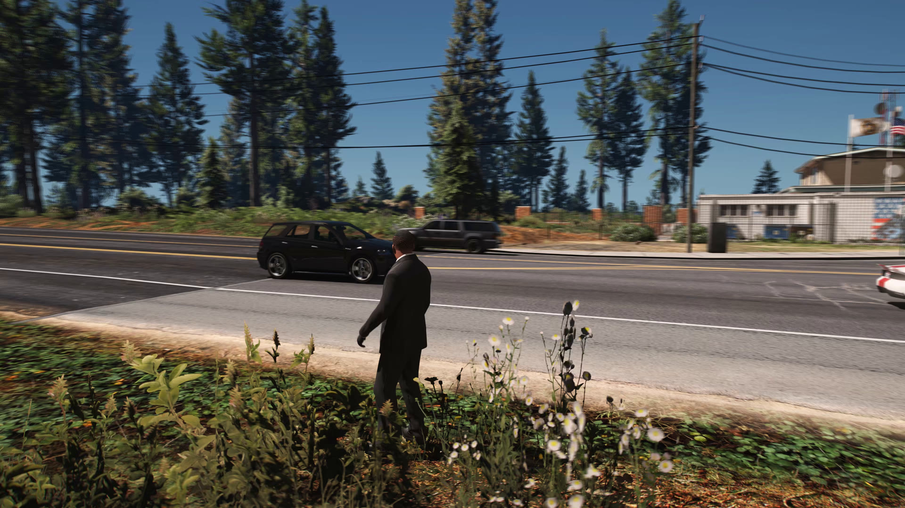
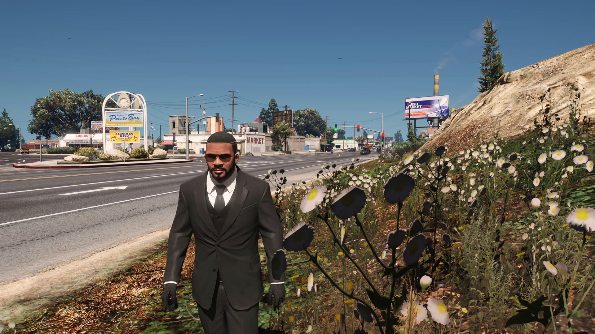
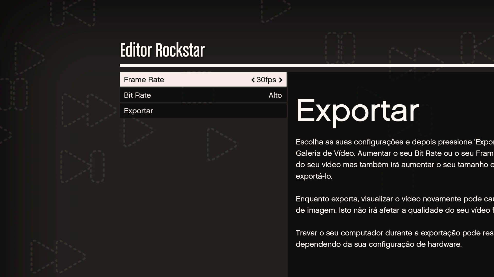

# GTA V Enhanced validation record

This record identifies the exact environment used for the public evidence in
the repository. It is evidence of a successful test on that build, not a claim
that future GTA updates will remain compatible.

## Test environment

Validation date: **July 30, 2026**

The installed game had received Rockstar's
[GTAV Title Update 1.73](https://support.rockstargames.com/articles/4vRqEDvjUs9h7nqRUgc8YO/gtav-title-update-1-73-notes-ps5-ps4-xbox-series-x-or-s-xbox-one-pc-enhanced-legacy),
dated July 16, 2026. The executable metadata was read directly from the tested
Steam installation.

| Component | Version | SHA-256 |
| --- | --- | --- |
| `GTA5_Enhanced.exe` | `1.0.1158.13` | `0C52864D4521D9C9D441348AA1156958792DDE8825D0297C851753F167336401` |
| `ScriptHookV.dll` | `3889.0.1158.13` | `126BE57CA9DCA00E471F9DE611766009C900AAD88F89AE6C2926EC62E5AAEB4F` |
| `ReShade.asi` | `6.7.3.4` / product `6.7.3 NVE` | `10DDA6710154B81501B196ED1E7991765519846358A17D99C85668B7F97AFF14` |

The game, ScriptHookV, and ReShade binaries are not distributed by this
repository. Their hashes are included only to make the test environment
unambiguous.

## AV1 4K/120 GPU motion-blur test

- Rockstar Editor export at 3840x2160.
- AV1 NVENC Main profile, 8-bit YUV420.
- Exact 120 FPS output.
- Three additional motion-blur samples, strength 1.0: four temporal samples per
  output frame and 480 effective renders per second.
- 1,852 encoded frames and zero dropped frames.
- Video duration 15.433333 seconds; AAC stereo 48 kHz audio duration 15.434000
  seconds in the independently probed final file.
- Full decode completed without an error.
- GPU accumulation used an RGBA16F DirectX 12 target and one color readback per
  output frame.
- Clean pre-UI frame capture: no Rockstar progress controls or watermark in the
  decoded evidence frames.

The full-resolution source evidence frame had SHA-256
`177FA3986A77F6251A03EF39153050B73A267D118BBE246A965AD0DC7EE59F0F`.
The tracked JPEG below is a downscaled preview of that frame.

## 4K/240 high-frame-rate test

- Rockstar Editor export at 3840x2160.
- H.264 NVENC with AAC stereo audio.
- Exact 240 FPS output through the automatic audio-first/video-second path.
- 3,704 encoded frames, zero dropped frames, and 1.33 ms encoder-side A/V
  duration delta.
- Clean pre-UI frame capture.

The full-resolution source evidence frame had SHA-256
`F11814A1CD67863EFBB9619DE3AB6E019B83403467BCD8BAFDD643604D1A7343`.

## Rockstar Editor workflow

The automation loaded a saved Rockstar Editor project and started the regular
export action shown below. Successful completion was detected only after EVER
logged `Async FFmpeg finalization completed successfully`.

## Interpreting compatibility

EVER Enhanced validates version-specific function signatures before installing
its internal hooks. A later game build can be unsupported even when it launches
successfully. Users should compare their `GTA5_Enhanced.exe` file version with
the supported version in the release notes and should not bypass a failed
signature check.
